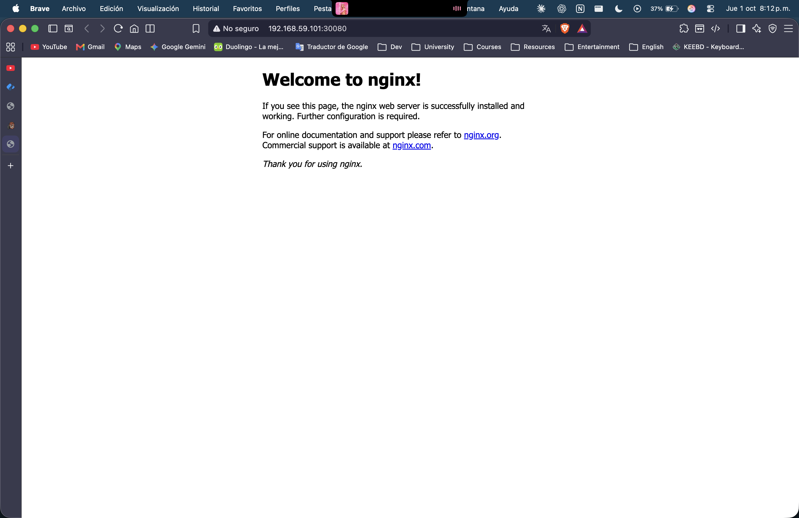

# VIRTUALIZACI-N
Repositorio para tareas generales y parciales del curso de Virtualización
# HW-05 - Kubernetes Nginx Service

## Descripción

Configuración de un servicio Nginx utilizando Kubernetes mediante archivos YAML como Infrastructure as Code (IaC).

## Deployment

Se creó un Deployment de Nginx utilizando la imagen oficial de Nginx.

Archivo:

`k8s/deployment.yaml`

## Service

Se creó un Service de tipo NodePort para permitir el acceso al servidor Nginx desde el navegador local.

Archivo:

`k8s/service.yaml`

## Acceso desde el navegador

Se realizó una llamada al servicio de Nginx desde el navegador y se obtuvo la página predeterminada de Nginx.

## Salida de kubectl get svc

❯ k get svc
NAME            TYPE        CLUSTER-IP       EXTERNAL-IP   PORT(S)        AGE
kubernetes      ClusterIP   10.96.0.1        <none>        443/TCP        8d
nginx-service   NodePort    10.102.105.205   <none>        80:30080/TCP   31h