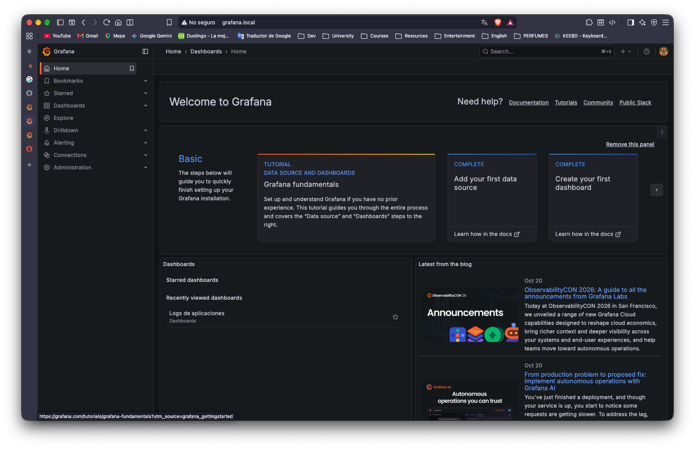
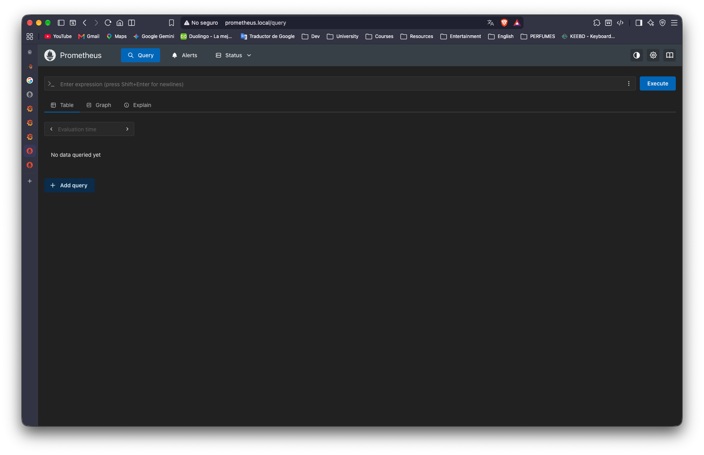
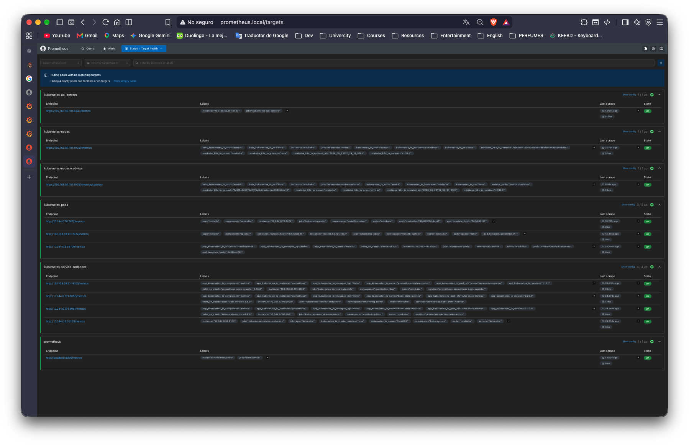
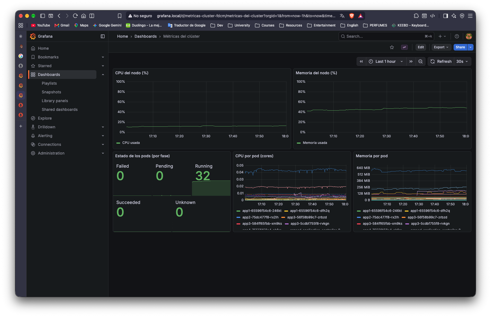
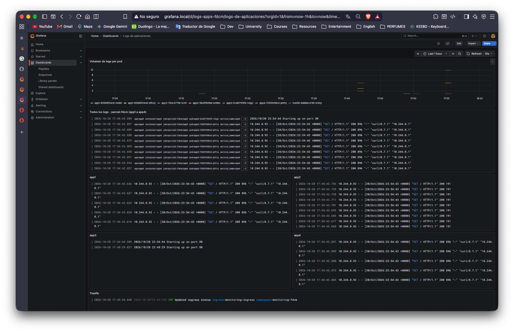
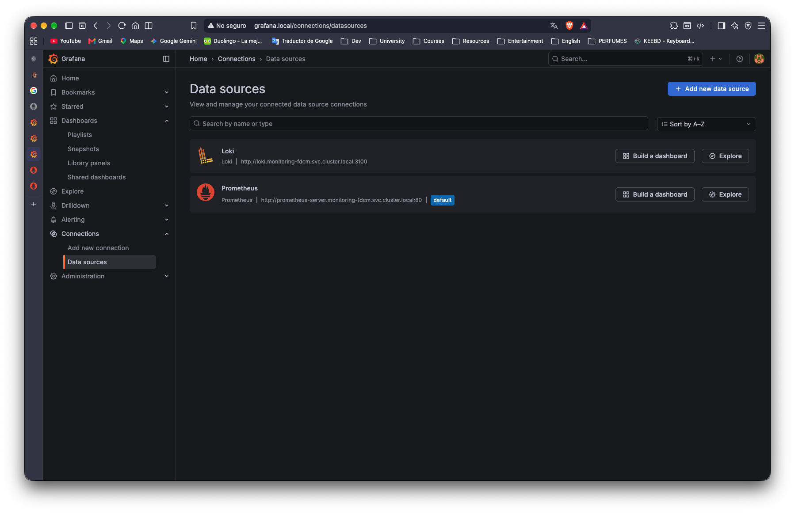

# VIRTUALIZACI-N
Repositorio para tareas generales y parciales del curso de Virtualización

---

# Proyecto personal 01: Monitoreo y logs en Kubernetes

En esta actividad instalé un stack de monitoreo dentro del clúster de Minikube que ya tenía de la actividad anterior (con MetalLB y Traefik). Los componentes son Prometheus, Loki, Promtail y Grafana, todos en el namespace `monitoring-fdcm`.

Todo está hecho con Helm y los `values.yaml` están en la carpeta `monitoring/`.

## Versiones usadas

| Componente | Chart de Helm | Versión del chart | Versión de la app |
|---|---|---|---|
| Prometheus | prometheus-community/prometheus | 29.37.0 | v3.15.0 |
| Loki | grafana/loki | 7.3.0 | 3.6.12 |
| Promtail | grafana/promtail | 6.17.1 | 3.5.1 |
| Grafana | grafana/grafana | 10.5.15 | 12.3.1 |

## 0. Preparación

### Más recursos para Minikube

Mi clúster tenía solo 2 CPUs y unos 5.7 GB de RAM, que se me hacía poco para todo el stack. Como uso el driver de VirtualBox, subí los recursos de la VM sin borrar el clúster:

```bash
minikube stop
VBoxManage modifyvm minikube --cpus 4 --memory 8192
minikube start
```

Después comprobé con `minikube ssh -- nproc` y `minikube ssh -- free -m` que ya tenía 4 CPUs y unos 7.8 GB.

(El `minikube stop` se me quedó trabado y tuve que apagar la VM a la fuerza con `VBoxManage controlvm minikube poweroff`.)

### Namespace y repos de Helm

```bash
k apply -f monitoring/namespace.yaml

helm repo add prometheus-community https://prometheus-community.github.io/helm-charts
helm repo add grafana https://grafana.github.io/helm-charts
helm repo update
```

El namespace se llama `monitoring-fdcm` (monitoring- + mis iniciales).

## 1. Prometheus

Archivo: `monitoring/prometheus/values.yaml`

Desactivé Alertmanager y Pushgateway porque no los necesito. Dejé activos `kube-state-metrics` (para el estado de los pods) y `node-exporter` (para CPU y memoria del nodo). Le puse un volumen de 5Gi con el StorageClass `standard` y retención de 7 días.

```bash
helm upgrade --install prometheus prometheus-community/prometheus \
  --version 29.37.0 \
  --namespace monitoring-fdcm \
  -f monitoring/prometheus/values.yaml
```

Primero los pods se quedaron en `ErrImagePull`. Al ver los eventos con `kubectl describe` salía `lookup registry.k8s.io: no such host`, o sea que la VM tuvo un fallo de DNS al bajar las imágenes. Probé el `nslookup` desde la VM (`minikube ssh`), ya resolvía bien, y al borrar los pods con `k delete pod -n monitoring-fdcm --all` las imágenes bajaron y quedaron en `Running`.

Para verificar los targets abrí `http://prometheus.local/targets` y todos estaban en UP (captura abajo).

## 2. Loki

Archivo: `monitoring/loki/values.yaml`

Lo instalé en modo `SingleBinary` con almacenamiento en el filesystem (un volumen de 5Gi), porque es lo más liviano para un clúster local. Desactivé el gateway, minio, las cachés y el canary para ahorrar memoria. También puse `auth_enabled: false` y el esquema `tsdb` v13.

```bash
helm upgrade --install loki grafana/loki \
  --version 7.3.0 \
  --namespace monitoring-fdcm \
  -f monitoring/loki/values.yaml
```

Nota: al simular con `helm template` me salió un error de `loki.storage.bucketNames.chunks`, pero la instalación real con el mismo archivo sí funcionó y `loki-0` quedó en `2/2 Running`. Comprobé con `helm get values loki -n monitoring-fdcm` que lo instalado coincide con el archivo del repo.

Para probarlo hice un port-forward y `curl http://localhost:3100/ready`, que respondió `ready`.

## 3. Promtail

Archivo: `monitoring/promtail/values.yaml`

Promtail corre como DaemonSet (un pod por nodo). Lo configuré para mandar los logs a Loki en:

```
http://loki.monitoring-fdcm.svc.cluster.local:3100/loki/api/v1/push
```

Para recolectar solo lo que pide la actividad agregué un `relabel` con `action: keep` que deja pasar únicamente los logs de los namespaces `parcial-fdcm` (las 4 apps) y `traefik`. Todo lo demás se descarta.

```yaml
config:
  snippets:
    extraRelabelConfigs:
      - source_labels: [__meta_kubernetes_namespace]
        regex: parcial-fdcm|traefik
        action: keep
```

```bash
helm upgrade --install promtail grafana/promtail \
  --version 6.17.1 \
  --namespace monitoring-fdcm \
  -f monitoring/promtail/values.yaml
```

Helm avisa que el chart está deprecated, pero lo usé igual porque la actividad pide Promtail.

Para comprobar que llegaban los logs consulté las etiquetas de Loki:

```bash
curl -s "http://localhost:3100/loki/api/v1/label/pod/values"
```

Salieron los pods de `app1` (las 2 réplicas), `app2`, `app3`, `app4` y el de Traefik.

## 4. Grafana

Archivo: `monitoring/grafana/values.yaml`

```bash
helm upgrade --install grafana grafana/grafana \
  --version 10.5.15 \
  --namespace monitoring-fdcm \
  -f monitoring/grafana/values.yaml
```

Usuario `admin` y contraseña `admin-fdcm-lab` (es solo para la práctica local).

### Data sources como código

Están en el mismo `values.yaml`, en la sección `datasources` (provisioning), así que no los configuré a mano desde la interfaz:

- **Prometheus** (uid `prometheus`, default): `http://prometheus-server.monitoring-fdcm.svc.cluster.local:80`
- **Loki** (uid `loki`): `http://loki.monitoring-fdcm.svc.cluster.local:3100`

En la interfaz probé los dos con "Save & test" y ambos dieron conexión exitosa.

### Dashboards como código

Activé el sidecar de Grafana (`sidecar.dashboards`) para que cargue automáticamente cualquier ConfigMap con la etiqueta `grafana_dashboard=1` del namespace. Cada dashboard tiene su JSON y su ConfigMap en `monitoring/grafana/dashboards/`:

- `metricas-cluster.json`: CPU y memoria del nodo, estado de los pods por fase, CPU por pod y memoria por pod.
- `logs-apps.json`: volumen de logs por pod, un panel con todos los logs de `parcial-fdcm`, un panel por cada app (app1 a app4) y uno de Traefik.

Los ConfigMaps se generaron así (ejemplo con el de métricas):

```bash
k create configmap dashboard-metricas-cluster -n monitoring-fdcm \
  --from-file=metricas-cluster.json=monitoring/grafana/dashboards/metricas-cluster.json \
  --dry-run=client -o yaml \
  | k label --local -f - grafana_dashboard=1 -o yaml \
  > monitoring/grafana/dashboards/metricas-cluster-configmap.yaml

k apply -f monitoring/grafana/dashboards/metricas-cluster-configmap.yaml
```

Y lo mismo para `logs-apps`.

Un detalle: al inicio los paneles de `app3` y de Traefik salían en "No data". Resulta que `app3` solo escribe una línea cuando arranca y Traefik solo escribe eventos propios (no tiene access logs activados), y el dashboard solo miraba la última hora. Reinicié `app3` con `k rollout restart deployment/app3 -n parcial-fdcm` y con eso ya aparecieron datos de las 4 apps y de Traefik.

## 5. Exposición con Traefik y DNS

Archivo: `monitoring/ingress/ingress.yaml`

Usé un `Ingress` normal con `ingressClassName: traefik`, igual que en las apps de la actividad anterior, con dos hosts:

- `grafana.local` → servicio `grafana` (puerto 80)
- `prometheus.local` → servicio `prometheus-server` (puerto 80)

```bash
k apply -f monitoring/ingress/ingress.yaml
k get ingress -n monitoring-fdcm
```

El Ingress tomó la IP del LoadBalancer de MetalLB: `192.168.59.240`.

Para el DNS local agregué esta línea en `/etc/hosts`:

```
192.168.59.240 grafana.local prometheus.local
```

```bash
echo "192.168.59.240 grafana.local prometheus.local" | sudo tee -a /etc/hosts
```

Antes de tocar el `/etc/hosts` probé con el header `Host` para ver si Traefik respondía:

```bash
curl -s -o /dev/null -w "%{http_code}\n" -H "Host: grafana.local" http://192.168.59.240/login        # 200
curl -s -o /dev/null -w "%{http_code}\n" -H "Host: prometheus.local" http://192.168.59.240/-/ready   # 200
```

Un detalle: el `ping` a `grafana.local` da `Destination Host Unreachable`, pero es normal porque la IP de MetalLB no responde ICMP. Lo que importa es que por el navegador carga bien.

## Capturas de pantalla

**Grafana con el dominio**



**Prometheus con el dominio**



**Targets de Prometheus en UP**



**Dashboard de métricas del clúster**



**Dashboard de logs (app1 a app4 y Traefik)**



**Data sources provisionados**



## Problemas que tuve

- La VM de Minikube tenía pocos recursos, la subí a 4 CPUs y 8 GB.
- `minikube stop` se trabó y apagué la VM con `VBoxManage controlvm minikube poweroff`.
- Algunos pods se quedaron en `ErrImagePull` por un fallo de DNS en la VM. Se arregló al reintentar borrando los pods.
- `helm template` de Loki daba un error de `bucketNames`, aunque la instalación real funcionó.
- Los paneles de `app3` y Traefik salían vacíos porque casi no generan logs; reinicié `app3` y subí el rango de tiempo.
