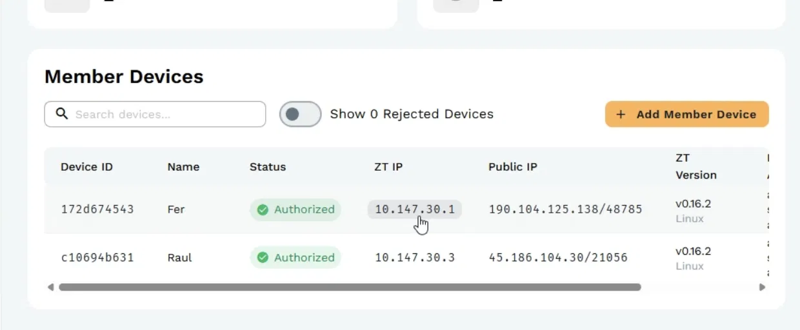
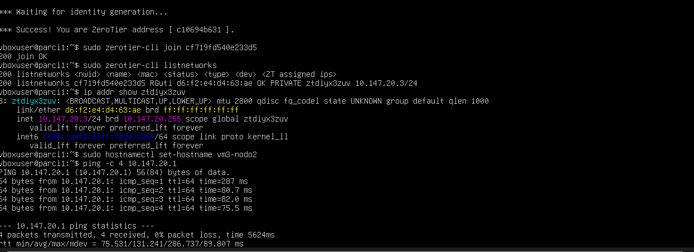
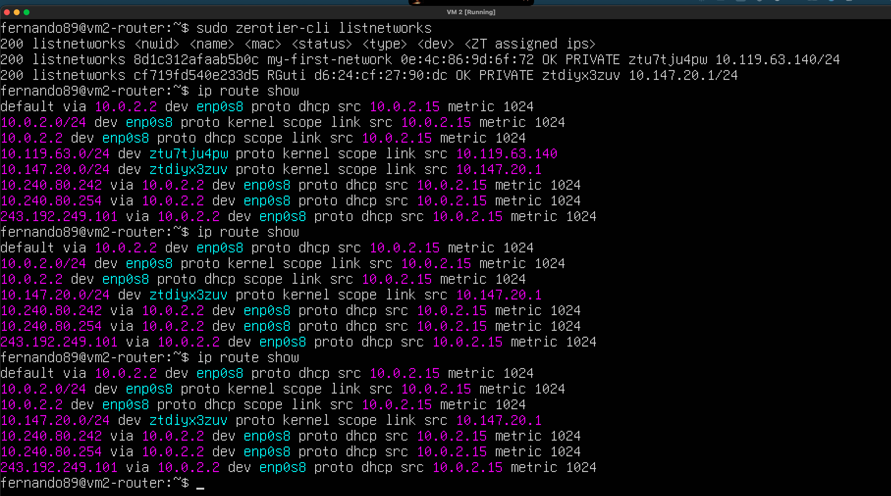
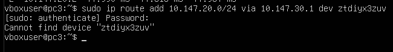
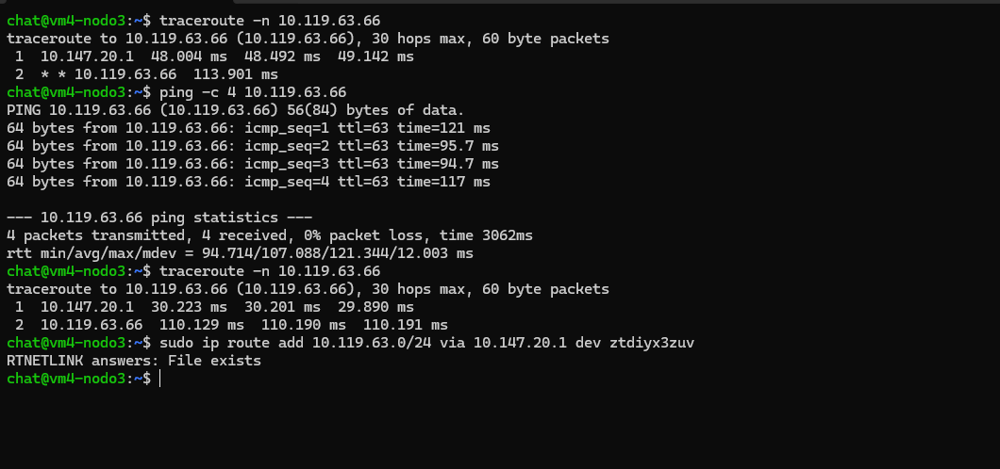
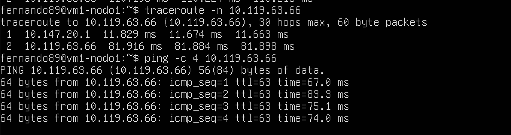
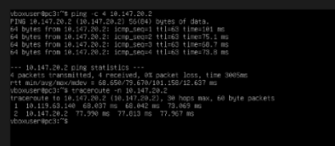
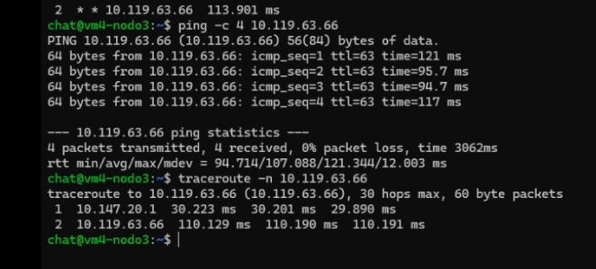

# VIRTUALIZACIÓN

Repositorio para tareas generales y parciales del curso de Virtualización.

## Actividad: Red Virtual Privada (SDN) con ZeroTier

En esta actividad se utilizó **ZeroTier** para generar una red virtual privada (SDN) que interconecta cuatro máquinas virtuales, incluyendo la configuración de una de ellas como **router** para enlazar dos redes ZeroTier distintas.

---

## 1. Introducción

Se implementó una red virtual privada con ZeroTier interconectando 4 máquinas virtuales distribuidas en dos computadoras físicas distintas. Debido a que el plan gratuito de ZeroTier Central no permite administrar Managed Routes cruzadas entre redes creadas por distintas cuentas, se optó por un diseño con **dos redes ZeroTier**, donde una de las máquinas (`vm2-router`) pertenece a ambas y actúa como puente/router entre ellas, habilitando IP forwarding y las rutas de enrutamiento necesarias a nivel de sistema operativo.

---

## 2. Topología de red

| Red | Network ID | Miembros | Rango |
|---|---|---|---|
| Red A | `cf719fd540e233d5` | vm1-nodo1, vm2-router, vm4-nodo3 | `10.147.20.0/24` |
| Red B | `8d1c312afaab5b0c` | vm2-router, vm3 (pc3) | `10.119.63.0/24` |

| Máquina | Hostname | IP Red A | IP Red B |
|---|---|---|---|
| VM 1 | vm1-nodo1 | 10.147.20.2 | — |
| VM 2 (router) | vm2-router | 10.147.20.1 | 10.119.63.140 |
| VM 3 | pc3 | — | 10.119.63.66 |
| VM 4 | vm4-nodo3 | 10.147.20.4 | — |

`vm2-router` es miembro de ambas redes simultáneamente. Con IP forwarding habilitado y las rutas correspondientes, actúa como puente: cualquier tráfico entre un equipo de la Red A (vm1 o vm4) y el equipo de la Red B (vm3) debe pasar obligatoriamente a través de `vm2-router`, ya que no existe conexión directa peer-to-peer posible entre máquinas de redes ZeroTier distintas.

```
Red A (10.147.20.0/24)                    Red B (10.119.63.0/24)
┌─────────────┐                                  ┌─────────────┐
│  vm1-nodo1  │──┐                            ┌───│     pc3     │
│ 10.147.20.2 │  │                            │   │10.119.63.66 │
└─────────────┘  │      ┌──────────────┐      │   └─────────────┘
                  ├──────│  vm2-router  │──────┤
┌─────────────┐  │      │ 10.147.20.1  │      │
│  vm4-nodo3  │──┘      │10.119.63.140 │      │
│ 10.147.20.4 │         └──────────────┘      │
└─────────────┘                               │
                                    (IP forwarding + rutas)
```

---

## 3. Creación de las redes en ZeroTier Central

### Red A (`cf719fd540e233d5`)


Miembros de la Red A ya agregados y autorizados:


### Red B (`8d1c312afaab5b0c`)


---

## 4. Unión de las máquinas a la red (join)

### VM 1 — vm1-nodo1
 5.47.04 p. m..png>)

### VM 2 — vm2-router


### VM 3 — pc3
 5.55.42 p. m..png>)

### VM 4 — vm4-nodo3
Unida a la Red A con IP asignada `10.147.20.4/24` (ver evidencia en la sección de rutas administradas, punto 8).

---

## 5. Asignación de IPs estáticas

Las IPs se asignaron desde el panel de **Members** de cada red en ZeroTier Central, autorizando cada dispositivo y fijando su dirección dentro del rango correspondiente (ver capturas de las secciones 3 y 4). Resumen de IPs asignadas:

- vm1-nodo1 → `10.147.20.2/24` (Red A)
- vm2-router → `10.147.20.1/24` (Red A) y `10.119.63.140/24` (Red B)
- pc3 → `10.119.63.66/24` (Red B)
- vm4-nodo3 → `10.147.20.4/24` (Red A)

---

## 6. Configuración del hostname

Se configuró el nombre de host de cada máquina con `hostnamectl set-hostname`:

- VM 1 → `vm1-nodo1`
- VM 2 → `vm2-router`
- VM 3 → `pc3`
- VM 4 → `vm4-nodo3`

*(Agregar aquí captura de `hostnamectl` de cada máquina confirmando el nombre asignado.)*

---

## 7. Configuración del router (vm2-router)

Se habilitó IP forwarding en `vm2-router` para permitir el reenvío de tráfico entre la Red A y la Red B:

```bash
sudo sysctl -w net.ipv4.ip_forward=1
echo "net.ipv4.ip_forward=1" | sudo tee -a /etc/sysctl.conf
sudo sysctl -p
```

Verificación de que `vm2-router` pertenece a ambas redes:

 6.09.17 p. m..png>)

 6.16.35 p. m..png>)
 6.19.04 p. m..png>)

---

## 8. Rutas administradas / rutas de enrutamiento

Debido a que el plan gratuito de ZeroTier Central no permite configurar Managed Routes entre redes administradas por cuentas distintas, se configuraron manualmente las rutas equivalentes a nivel de sistema operativo (`ip route`) en cada máquina, apuntando hacia `vm2-router` como puerta de enlace entre ambas redes.

### VM 1 (hacia la Red B, vía el router)
```bash
sudo ip route add 10.119.63.0/24 via 10.147.20.1 dev ztdiyx3zuv
```
 11.20.28 p. m..png>)

### VM 3 (hacia la Red A, vía el router)
```bash
sudo ip route add 10.147.20.0/24 via 10.119.63.140 dev ztu7tju4pw
```


### VM 4 (hacia la Red B, vía el router)
```bash
sudo ip route add 10.119.63.0/24 via 10.147.20.1 dev ztdiyx3zuv
```


---

## 9. Pruebas de conectividad (ping y traceroute)

Se realizaron pruebas de ping entre todas las máquinas de la red. Para las pruebas entre máquinas de redes distintas (que obligatoriamente deben pasar por el router), se utilizó adicionalmente `traceroute` para confirmar el número de saltos y verificar que el primer salto correspondiera a `vm2-router`.

### VM 1 → VM 3 (a través del router)
Traceroute confirma 2 saltos: `10.147.20.1` (router) → `10.119.63.66` (vm3).


### VM 3 → VM 1 (ruta de regreso, a través del router)


### VM 4 → VM 3 (a través del router)


*(Agregar también capturas de ping VM1↔VM2, VM4↔VM2 y VM1↔VM4, que al estar en la misma red — Red A — se conectan de forma directa sin pasar por el router.)*

---

## 10. Conclusión

Se cumplieron los seis requisitos mínimos de la actividad: se creó una red virtual en ZeroTier Central (y una segunda red complementaria para poder demostrar el enrutamiento entre subredes distintas), las cuatro máquinas virtuales se unieron exitosamente mediante el cliente de ZeroTier, cada una recibió una dirección IP estática dentro del rango correspondiente, se configuró `vm2-router` como puente entre ambas redes habilitando IP forwarding y las rutas necesarias, se asignó un hostname único a cada máquina, y finalmente se comprobó mediante pruebas de ping y traceroute que la conectividad entre todas las máquinas funciona correctamente, verificando que el tráfico entre equipos de redes distintas efectivamente atraviesa el router antes de llegar a su destino.

---

## Video demostrativo

[Enlace al video](https://youtu.be/bjbUW7rfQ6Y)