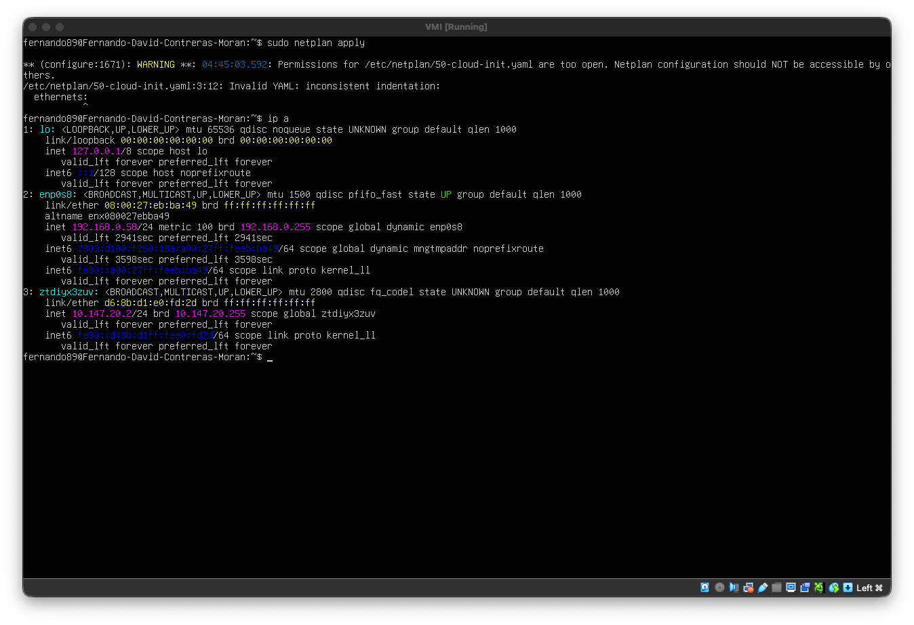

# Virtualización — HW-03: Configuración de Red en Modo Bridge

Repositorio para tareas generales y parciales del curso de Virtualización.

Máquina virtual: **Ubuntu Server** (VirtualBox)
Hostname configurado: `Fernando-David-Contreras-Moran`

---

## Configuración del adaptador en modo Bridge

Cambio del adaptador de red a **Bridge (Adaptador puente)** desde VirtualBox:


---

## Hostname

Confirmación del hostname configurado en la VM:


---

## Escenario 1 — IP asignada por DHCP

IP obtenida automáticamente por DHCP dentro de la red bridge y verificación de conectividad con `ping -c 4 google.com`:


---

## Escenario 2 — IP manual dentro de la subred

Archivo de configuración de netplan usado para asignar la IP manualmente, dentro del mismo rango del router:


Confirmación de que los cambios se aplicaron correctamente:


Nueva IP asignada tras aplicar la configuración:



IP resultante y verificación de conectividad con `ping -c 4 google.com`:


---

## Escenario 3 — IP manual fuera de la subred del hipervisor

Nueva configuración de netplan con IP fuera del rango de la subred del hipervisor:


IP resultante y verificación de conectividad con `ping -c 4 google.com`:


---

## Subred del hipervisor

Verificación de la subred del hipervisor (host) para confirmar que la asignación de IPs en los Escenarios 1 y 2 correspondió al rango correcto:

```
inet 192.168.0.16 netmask 0xffffff00 broadcast 192.168.0.255
```

---
