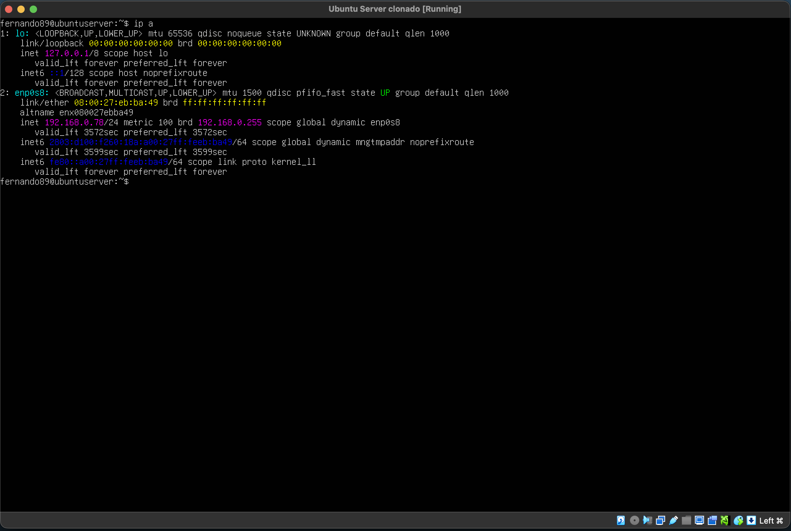
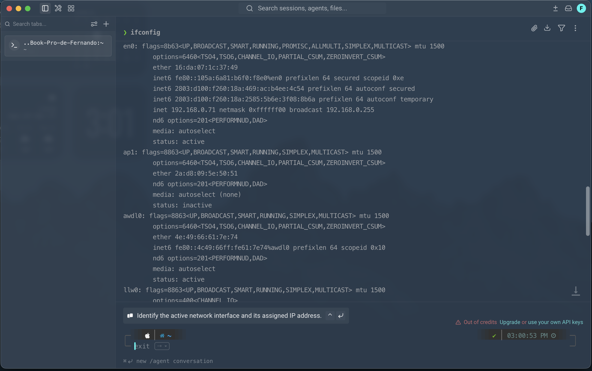

# 🖥️ Virtualización

Repositorio para las tareas generales y parciales del curso de **Virtualización**.

---

## HW-01 — Comunicación entre Host y Servidor Virtual

###  Configuración de red — Máquina Host

---

###  Configuración de red — Servidor Virtual

---

### Prueba de conectividad — Ping VM → Host

